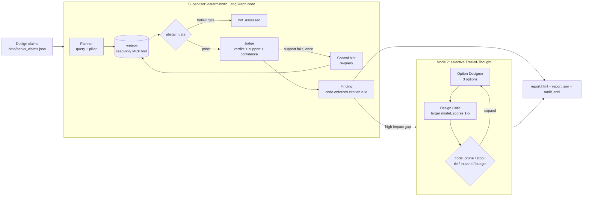

# DesignBench

**A research agent that reviews an agent-payment system design against the OWASP Top 10 for Agentic Applications (ASI01–ASI10), cites a verified clause for every finding, and says "not assessed" when it has no evidence.**

Capstone project, CMU Agentic AI program (2026). All inputs are synthetic (a fictional "Bank X") or public standards. No real bank's data or systems are used.

> **Status:** working end to end. 71 offline tests pass; one live run with Claude on 2026-11-14 matched the author's labels on verdict **and** control for 9 of 11 claims, with zero false assurance and zero failed calls. See [`eval/RESULTS.md`](eval/RESULTS.md).

---

## The problem

Designs for agents that move money (payment agents, mandates, tool gateways, multi-agent fraud checks) are reviewed by senior architects reading documents against security standards. That review is slow, depends on who is in the room, and leaves no evidence of *why* a design passed. The worst failure is **false assurance**: a real gap reported as fine.

DesignBench gives the architect a first-pass review in minutes. Each design claim comes back as `gap`, `ok` or `not_assessed`, tied to the standards clause it rests on, and each high-impact gap comes with compared fix options. **A human still decides**; the agent's only tool is read-only retrieval, so its risk is a wrong judgement, never a wrong action.

**Intended user:** a solution or security architect preparing a design for an architecture review board.

## How it works



- **Mode 1 (every claim), sequential:** plan, retrieve, judge, write. One re-query is allowed per claim (six per run) when the gate passes but the clause does not support the claim.
- **Mode 2 (high-impact gaps only, at most three):** a beam search over fix options (width 2, depth 3; widen to 3 once on a tie, deepen to 4 once). The critic only scores; **code** computes the weighted total and decides.
- **Four LLM roles, one supervisor that is not an LLM.** Separate roles exist where a viewpoint would otherwise be lost: the planner never cites, the judge never proposes, and the critic is a larger model than the designer, so no one grades their own work.

### Hard rules (in code, not in prompts)

1. `gap` or `ok` is impossible without a cited clause that passed the support check; an unverified chunk can never be the sole support.
2. Any tool error, model error, schema failure or budget hit ends as `not_assessed` / `unconfirmed`, never as a verdict (fail-closed).
3. Retrieved text is wrapped as untrusted data; the model must answer in schema-validated JSON.
4. The review agent has exactly one tool, read-only `retrieve`. The branch store for Tree-of-Thought is a separate MCP server.
5. Hard caps: 2 retries per call, 60 calls per gap, 100 calls and 200k tokens per run; every call is written to an audit log.

## Quick start

Requires **Python 3.10+** (the macOS system `python3` is 3.9 and will not work).

```bash
git clone https://github.com/minh-tn100/030-cmu-public.git designbench && cd designbench
make setup        # creates .venv, installs deps + spaCy model (needs network once)
make test         # 71 tests, offline, no API key
make demo-stub    # full review with a deterministic stub model -> out-stub/report.html
```

Run with a real Claude model (your own key; synthetic data only):

```bash
export ANTHROPIC_API_KEY=...                 # never commit it
export DB_JUDGE_MODEL=claude-sonnet-5-5      # planner, hint, judge, option designer
export DB_CRITIC_MODEL=claude-opus-5-5       # design critic (larger model)
make demo-claude  # -> out-claude/report.html, RESULTS.md, audit.jsonl (~44 calls, ~27k tokens)
```

Other targets: `make recall` (retrieval recall), `make eval` (stub agent eval), `make clean`. CLI options: `python cli.py review --help` (`--design`, `--standards`, `--max-calls`, `--max-tokens`, `--max-gaps`, `--compare`). Details and what to check after a live run: [`RUN_LIVE.md`](RUN_LIVE.md).

**No key?** Open the committed sample run instead: [`eval/live-20261114/report.html`](eval/live-20261114/report.html).

## Results (summary)

| | Stub (offline) | Claude, live, 2026-11-14 |
|---|---|---|
| Verdict and ASI control both match label | 10/11 | **9/11** |
| False assurance (true gap reported "ok") | 0 | **0** |
| gap/ok with a verified citation | 100% | **100%** |
| Failed model calls | – | **0** |
| Tree-of-Thought recommendation | – | **3/3** high-impact gaps |
| Calls / tokens | 0 | 44 / ~27k |

Retrieval (offline): hybrid recall@4 = 22/23; the abstain gate stops 3 of 5 out-of-scope queries. The first live run found **three bugs the stub never triggered** (pillar mismatch, truncated critic output, JSON wrapped in prose); all are fixed and pinned by tests. Full tables, cost against the design estimates, and what the numbers do **not** show: [`eval/RESULTS.md`](eval/RESULTS.md).

## Repository layout

| Path | What it is |
|---|---|
| `agent/graph.py` | Supervisor: LangGraph review loop (Mode 1), re-query edge, fail-closed writes |
| `agent/tot.py` | Selective Tree-of-Thought (Mode 2): designer, critic, pure decision functions |
| `agent/gateway.py` | The only place a model is called: retries, timeout, per-role output caps, JSON-schema check, budget, audit log |
| `agent/claude_llm.py` | Claude planner / hint / judge behind the same protocol as the stub |
| `agent/llm.py` | Deterministic stub model for offline runs and tests |
| `agent/schema.py` | `Finding` type that enforces the citation rule |
| `agent/pipeline.py`, `cli.py`, `agent/report_html.py` | End-to-end run and offline HTML report |
| `mcp_server/server.py` | Read-only retrieval MCP server (input validation, abstain gate, provenance) |
| `mcp_server/branch_store.py`, `branch_server.py` | SQLite option-tree store and its own MCP server |
| `retrieval/` | Sparse + dense hybrid index, static or sentence embedder, gate |
| `data/` | Synthetic Bank X design and claims, labels, impact ratings, standards corpus |
| `eval/` | Recall, agent eval, run evaluator; `RESULTS.md`; sample live run in `live-20261114/` |
| `tests/` | 71 tests (offline; fake and stub models) |
| `specs/` | Vision brief and feature PRDs for the build |
| `skills/`, `agent/skills.py`, `agent/skill_agent.py` | Post-capstone extension: an assistant that loads skills on demand. The review agent does not get this tool. |

### Libraries

LangGraph for orchestration (`StateGraph`), the Anthropic SDK called directly for model calls (no LangChain in the review path), the `mcp` Python SDK for both tool servers, scikit-learn and spaCy for retrieval. `langchain-core` appears only in the optional skills extension.

## How the design evolved

| Checkpoint | Decision that shaped the code |
|---|---|
| 1.1 | Research-assistant concept for an architect preparing a board review: cited gap register, per-pillar maturity scores, attack-scenario simulation, upgrade options |
| 2.1 | Plan-then-ReAct loop with a verify step; tool-call budget with "not assessed" as the stop result; the citation must *support* the finding, not just exist; escalation by impact, not self-reported confidence |
| 3.1 | Retrieval with an abstain gate and provenance; protocol chunks later found unverified and re-verified (`docs/CORPUS_VERIFICATION.md`) |
| 4.1 | Selective Tree-of-Thought only for high-impact gaps, with a rubric computed in code |
| 5.1 | Four LLM roles under a deterministic supervisor; hub communication, schema-validated JSON |
| 6.1 | Guardrails, metrics and human-intervention criteria; fail-closed everywhere |
| 7.1 | First live run; three integration bugs found and fixed; results measured, not estimated |

## Limitations

- **Labels are the author's own.** No second labeler; 9/11 is weak evidence of accuracy. C02 and C09 are genuine judgement calls.
- **One live run** after the fixes; run-to-run variance is unmeasured.
- **The support check is lexical.** It let a wrong citation through in the stub run (C10); it is not yet replaced by a model-based check.
- **Protocol corpus not used in review.** AP2, ACP, MCP and A2A chunks are in the corpus and reachable through the retrieval server (`pillar=interoperability`), but the review agent checks claims against OWASP ASI only.
- **Designed in Checkpoint 6.1 but not built:** the AUTO / BATCH / HUMAN_NOW risk router, the injection scan and its 10-case test set, the review queue, the metrics dashboard and the off switch.
- **ToT's value is unproven.** It adds ~2.5–2.8k tokens per gap; whether its fixes beat the one-call baseline needs human review.
- **Scope narrowed from Checkpoints 1.1–2.1:** the attack-scenario simulator, the L1–L5 maturity scores and the long-term (semantic / episodic / procedural) memory were designed but not built. The build focused on the cited review loop and selective Tree-of-Thought.
- Claims are processed sequentially; parallel Mode 1 is a design, not code.

## Next steps

1. An independent second labeler, then `python -m eval.report_eval out-claude --labels2 theirs.json`.
2. Three to five repeated live runs to measure variance.
3. A model-based support check to replace the lexical one.
4. The code-only risk router from Checkpoint 6.1, with tests, and the injection test set.

## Data and licenses

- **Code:** MIT ([`LICENSE`](LICENSE)).
- **OWASP ASI text** in `data/corpus.json` (paraphrased) comes from the *OWASP Top 10 for Agentic Applications 2026*, OWASP GenAI Security Project, **CC BY-SA 4.0**; attribution is kept in each chunk's `src` field.
- **Protocol chunks** (AP2, ACP, MCP, A2A) are paraphrases of the public specifications, with sources and versions in [`docs/CORPUS_VERIFICATION.md`](docs/CORPUS_VERIFICATION.md).
- **Bank X** is entirely synthetic ([`data/bankx_design.md`](data/bankx_design.md)).

Model outputs in `eval/live-20261114/` were produced by Claude (Anthropic) on synthetic inputs.
